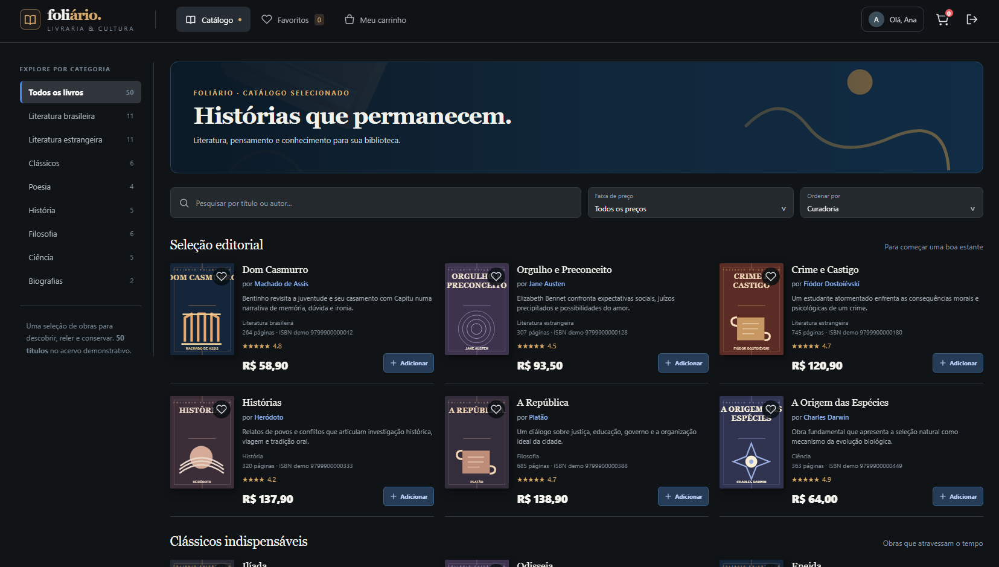
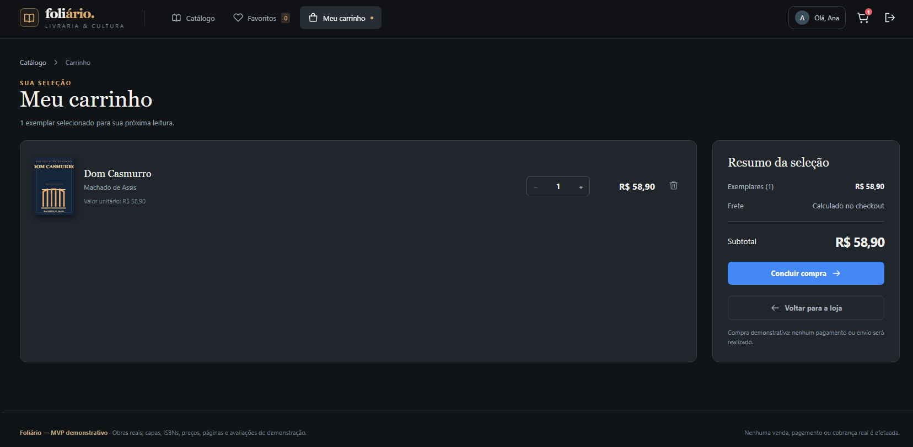
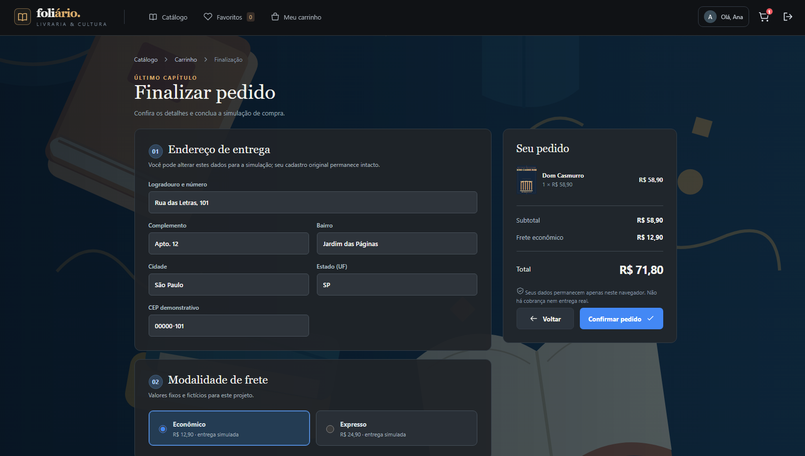

# Foliário — Livraria & Cultura

**Uma livraria virtual de demonstração, com a experiência de um e-commerce e a simplicidade de uma aplicação inteiramente local.**

**Status:** MVP funcional · **Idioma:** Português brasileiro · **Execução:** offline, sem instalação · **Natureza:** projeto demonstrativo



## Sobre o projeto

O **Foliário** é uma aplicação web de comércio eletrônico de **livros físicos**, criada como **prova de conceito (MVP — *Minimum Viable Product*)**. O projeto simula a jornada de um cliente em uma livraria digital: autenticar-se, explorar um catálogo, pesquisar obras, salvar favoritos, montar um carrinho e concluir um pedido fictício.

Seu propósito principal é **demonstrar a implementação de requisitos funcionais e visuais de um e-commerce com tecnologias nativas da Web**, sem recorrer a frameworks, servidores, APIs externas ou bancos de dados. O desenvolvimento também constitui um experimento de implementação de software assistida por inteligência artificial a partir de uma especificação de requisitos.

A interface segue uma linguagem visual **editorial, sóbria e contemporânea**: fundo grafite, nuances de azul profundo, acentos dourados, títulos serifados e capas ilustradas individualmente.

> [!IMPORTANT]
> **Este é um ambiente de simulação.** Nenhuma venda, cobrança, transferência financeira ou compra real é realizada. Todos os dados de clientes e de pagamento são demonstrativos.

## Objetivos

- Construir um **fluxo completo de compra simulada**, do login à confirmação do pedido.
- Reproduzir comportamentos típicos de uma livraria virtual, com interface responsiva e navegação intuitiva.
- Exercitar a separação lógica entre **apresentação, regras de negócio e dados** em uma aplicação sem backend executável.
- Demonstrar o uso de **CSV como fonte inicial de dados** e armazenamento local para preservar estados de navegação.
- Permitir que qualquer pessoa experimente o projeto **sem instalar dependências nem executar comandos**.

## Funcionalidades

| Área | Recursos implementados |
|---|---|
| **Autenticação** | Acesso com contas fictícias, validação de credenciais, exibição/ocultação de senha e logout. |
| **Catálogo** | 50 livros, busca por título ou autor, categorias, filtros por preço e ordenação. |
| **Detalhes das obras** | Modal com capa, sinopse, autor, avaliação, número de páginas, ISBN demonstrativo e preço. |
| **Favoritos** | Marcar/desmarcar obras e filtrar apenas os títulos favoritos. |
| **Carrinho** | Adicionar livros, alterar quantidades, remover itens e recalcular subtotais automaticamente. |
| **Checkout** | Revisar pedido, editar endereço de entrega, escolher frete e selecionar uma forma fictícia de pagamento. |
| **Confirmação** | Gerar identificação demonstrativa, exibir resumo final e limpar o carrinho ao concluir. |
| **Persistência** | Preservar carrinho e favoritos por usuário, quando o armazenamento local do navegador estiver disponível. |
| **Interface** | Layout responsivo, textos em português brasileiro, modais, feedback de ações e controles navegáveis por teclado. |

### As quatro telas principais

1. **Login:** entrada com uma das contas fictícias cadastradas.
2. **Catálogo:** descoberta de livros, pesquisa, filtros, detalhes e favoritos.
3. **Carrinho:** revisão de títulos, quantidades e valores.
4. **Checkout:** endereço, frete, pagamento ilustrativo e confirmação do pedido.

A visualização de **favoritos** funciona como um filtro do próprio catálogo, sem acrescentar uma quinta tela.

## Capturas de tela

| Login | Catálogo |
|:---:|:---:|
|  |  |

| Carrinho | Checkout |
|:---:|:---:|
|  |  |

<details>
<summary><strong>Visualizar a versão para dispositivos móveis</strong></summary>


</details>

## Tecnologias utilizadas

| Tecnologia | Utilização |
|---|---|
| **HTML5** | Estrutura das páginas e incorporação dos dados CSV necessários à execução local. |
| **CSS3** | Identidade visual, responsividade, layout, estados de interação e tipografia. |
| **JavaScript (Vanilla JS)** | Interatividade, autenticação demonstrativa, filtros, carrinho, cálculos e checkout. |
| **CSV** | Bases iniciais dos livros e dos usuários de demonstração. |
| **SVG** | Capas ilustrativas individuais e elementos decorativos locais. |
| **localStorage / sessionStorage** | Persistência de estados por usuário e manutenção da sessão, quando permitidas pelo navegador. |

**Sem dependências externas:** não há React, Angular, Vue, Node.js, npm, servidor HTTP, CDN, API externa ou banco de dados.

### Organização lógica

Embora o MVP funcione integralmente no navegador, o código contempla três responsabilidades:

- **Apresentação:** HTML e CSS, componentes de interface, navegação e responsividade.
- **Regras de negócio (backend simulado):** autenticação de teste, cálculo de valores, carrinho, favoritos, frete e criação fictícia de pedidos.
- **Dados:** registros CSV de livros e usuários, além do estado armazenado localmente.

**Não existe um backend real:** a autenticação e as operações de compra são simulações executadas em JavaScript no próprio navegador.

## Como executar

### Pré-requisitos

Apenas um navegador moderno (por exemplo, Chrome, Edge ou Firefox). **Não é necessário instalar nenhuma ferramenta.**

### Passo a passo

1. Faça o download ou clone deste repositório.
2. Abra a pasta do projeto.
3. Dê um duplo clique no arquivo **`index.html`**.
4. Utilize a aplicação no navegador, inclusive sem conexão com a internet.

A execução foi projetada para funcionar diretamente pelo protocolo `file://`. Não são necessários `npm install`, `npm start`, servidores locais nem configurações adicionais.

### Contas de demonstração

| Usuário | E-mail | Senha |
|---|---|---|
| Ana Beatriz Moura | `ana.moura@example.test` | `livros123` |
| Pedro Henrique Vieira | `pedro.vieira@example.test` | `livros123` |

Há **10 contas fictícias** no arquivo [`dados/usuarios.csv`](dados/usuarios.csv). A tela de login também oferece preenchimento facilitado das credenciais demonstrativas.

### Fluxo de utilização

**Entrar → explorar livros → adicionar ao carrinho → revisar quantidades → escolher frete e pagamento fictícios → confirmar pedido simulado.**

O checkout oferece **frete econômico (R$ 12,90)** e **expresso (R$ 24,90)**, além de seleção ilustrativa de **PIX, cartão de crédito ou boleto bancário**. Não são solicitados dados bancários ou números reais de cartão.

## Estrutura do repositório

```text
livraria-mvp/
├── index.html                # Aplicação completa (HTML, CSS e JavaScript)
├── README.md                 # Apresentação e documentação do repositório
├── dados/
│   ├── livros.csv            # Catálogo com 50 livros
│   └── usuarios.csv          # Cadastro com 10 usuários fictícios
├── assets/
│   ├── cenario.svg           # Ilustração de fundo
│   └── capas/
│       ├── livro-001.svg     # Capas demonstrativas individuais
│       ├── ...
│       └── livro-050.svg
└── docs/
    └── imagens/             # Capturas de tela usadas neste README
        ├── login.png
        ├── catalogo.png
        ├── carrinho.png
        ├── checkout.png
        └── mobile.png
```

## Dados e catálogo

O catálogo contém **50 obras e respectivos autores**, distribuídos por literatura brasileira e estrangeira, clássicos, poesia, história, filosofia, ciência e biografias. Cada registro inclui título, autor, sinopse, preço, ISBN, páginas, avaliação, categoria e caminho da capa.

- As **obras e autorias** correspondem a títulos reais.
- **Preços, números de páginas, avaliações e ISBNs são dados sintéticos**, não associados a edições comerciais específicas.
- As **capas SVG** são ilustrações demonstrativas próprias do projeto, e não reproduções de capas de editoras.
- Os **10 usuários**, endereços, CPFs e CEPs são fictícios. Os e-mails utilizam o domínio reservado `example.test`.

### Por que os CSVs também estão no `index.html`?

Navegadores podem restringir a leitura automática de arquivos locais via `fetch()` quando uma página é aberta pelo protocolo `file://`. Para cumprir o requisito de **execução offline e sem servidor**, o projeto conserva uma cópia dos dados CSV em blocos `script` de texto no próprio `index.html`.

Os arquivos [`dados/livros.csv`](dados/livros.csv) e [`dados/usuarios.csv`](dados/usuarios.csv) acompanham o repositório como fontes legíveis e editáveis. **Ao atualizar um CSV, também é necessário atualizar o respectivo bloco incorporado** (`csv-livros` ou `csv-usuarios`) no `index.html`, preservando a correspondência entre as versões.

## Regras e cuidados técnicos

- Valores monetários são calculados **em centavos inteiros** para evitar diferenças de arredondamento.
- Carrinho e favoritos são separados por **identificador de usuário**, sem compartilhamento entre contas.
- `localStorage` e `sessionStorage` são utilizados quando disponíveis; o programa mantém uma alternativa temporária em memória quando essas APIs estiverem bloqueadas.
- O checkout valida campos essenciais e impede a confirmação de pedidos sem itens.
- O layout adapta-se a computadores, tablets e smartphones.

## Limitações do MVP

Este repositório **não deve ser utilizado como loja em produção**. Em particular:

- As senhas de demonstração estão em **texto simples** nos dados locais: não há autenticação segura.
- Não existem serviços de backend, banco de dados, controle de estoque ou registros persistentes de pedidos.
- Não há processamento de pagamentos, cálculo real de frete, geração válida de boletos ou integração com transportadoras.
- Os dados do aplicativo permanecem no ambiente local do navegador, sujeitos às políticas de armazenamento do próprio navegador.
- O projeto não foi concebido para receber dados pessoais ou financeiros verdadeiros.

> **Pedido simulado — nenhuma compra ou cobrança foi realizada.**

---

**Foliário — Livraria & Cultura** · Um exercício de engenharia de software, experiência do usuário e desenvolvimento web com tecnologias nativas.
